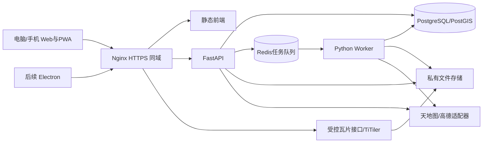

# 旅游规划软件完整实现方案

基线日期：2026-11-03。状态：产品与架构基线。代码已落地为可运行实现，实际结构与能力见 [ARCHITECTURE.md](ARCHITECTURE.md)，实现与方案的差异见 [DELIVERY.md](DELIVERY.md)。

## 1. 产品目标及已确定的范围

让用户在电脑上完成多日旅游规划，在手机上继续调整和查看，结合地图、景点信息、交通路径、自定义标注及 GIS 图层，形成可保存、回看、分享和导出的攻略。

核心闭环：创建行程 → 搜索/导入/自建地点 → 放入日期或候选池 → 安排交通与停留 → 检查冲突/优化 → 保存版本 → 手机查看/分享 → 导出 Markdown 或 DOCX。

### 1.1 Web 首版必须实现

| 模块 | 交付行为 |
| --- | --- |
| 账号 | 邮箱密码注册、验证、登录、退出、密码找回、会话管理；支持邀请注册或开放注册配置 |
| 行程 | 日期、每天起终点、住宿、景点/餐饮/交通事项、候选池、排序、跨天移动、复制、删除 |
| 地点 | 天地图/高德搜索、自有地点、点线面绘制、属性编辑、标签、备注、图片附件 |
| 地图 | 天地图道路/影像及注记切换、路线和地点联动、聚合、测距、图层管理 |
| 路径 | 驾车、步行、公交；仅在已验证的供应商能力下可用，供应商和查询时间可见 |
| 规划 | 手动规划、时间冲突检测、驾车/步行的单日及有限规模多日优化、预览与应用 |
| 历史 | 自动保存、版本列表、只读查看、恢复为新版本、行程复制 |
| 分享 | 可撤销/过期的只读链接、可选访问密码、允许接收者登录后复制 |
| 自定义数据 | GeoJSON/GPX/KML/CSV/ZIP Shapefile/GeoPackage、GeoTIFF 影像/DEM；GIS 服务图层 |
| 轻三维 | 2D/倾斜视角、可用 DEM 地形；同一行程在不同视角保持一致 |
| 攻略 | Markdown、带附件 ZIP、DOCX；包含时间表、位置、备注、预算、允许导出的配图 |
| PWA | 手机/电脑响应式页面、可安装入口、显式下载允许离线的攻略，离线只读 |
| 实用补充 | 必去/可选、开放/预约时间、预算、步行距离提示、天气入口、跳转外部导航 |

景点介绍、图片、门票、开放时间、预约链接按来源显示，允许用户补充；未知字段不编造。高德/天地图 POI 搜索不等同于完整旅游内容数据库。

### 1.2 明确暂缓

PDF、精细三维、Cesium/3D Tiles、完整离线地图及路网导航、航班/火车实时班次和票务预订、实时多人协同、原生手机应用、社交信息流、AI 自动生成事实内容。

Electron 在 Web 首版验收后单独实施。Web 首版的服务端批量 GIS 处理继续保留，不承诺浏览器或手机直接解析任意大文件。

### 1.2.1 Web 首版缺口清单（待办，2026-11-11 核对）

对照 §1.1 验收基线，以下条目尚未实现或只做了轻量版，后续迭代处理：

| 模块 | 缺口 | 现状 |
| --- | --- | --- |
| 自定义数据 | GeoJSON/GPX/KML/CSV/ZIP Shapefile/GeoPackage 上传导入、GeoTIFF 影像/DEM、GIS 服务图层 | 仅实现轻量专题点图层（MapLayer/MapLayerFeature，采集/打点/透明度/导出），dataset/瓦片链路见 §7 规划 |
| 地图 | 标注聚合（聚合显示） | 未实现 |
| 轻三维 | DEM 地形、2D/倾斜视角一致性 | 只有 2D/倾斜/旋转视角，无地形 |
| 地点 | 图片附件 | 未实现 |
| 账号 | 密码找回 | 未实现（注册/登录/退出/会话已有） |
| PWA | 可安装入口、离线只读攻略 | 未实现 |
| 历史 | 自动保存与恢复的交互完善 | 版本模型已有，页面交互待补 |

### 1.3 产品默认值

- 简体中文；新行程时区 Asia/Shanghai、货币 CNY、按日安排，时区使用 IANA 名称保存。
- 默认私有，生产默认邀请注册。未登录可访问首页及有效分享；规划工作台、上传、搜索等有成本接口要求登录。
- 先支持中国大陆；不以第一版覆盖全球时区、公共交通和数据源为验收条件。
- 每行程最多 30 天、每天最多 30 个事项、候选池最多 100 个地点；上限属于应用配置。
- “多人”只涉及分享/复制，只有所有者可以编辑。
- 初期单机部署，用户文件使用私有数据卷；通过存储接口预留 S3 兼容后端，不在初期强制部署对象存储集群。

## 2. 技术架构及版本策略

| 子系统 | 固定技术方向 | 责任 |
| --- | --- | --- |
| Web | React + TypeScript + Vite + React Router | 页面、响应式布局、路由 |
| UI | Ant Design + CSS Modules | 表单及通用控件；地图和手机抽屉自行布局 |
| 状态 | Zustand + TanStack Query | 暂存编辑/视图状态与服务端状态分离 |
| 地图 | MapLibre GL JS + Terra Draw + Turf.js | 渲染、绘制和轻量空间操作 |
| PWA | vite-plugin-pwa + Workbox + IndexedDB | 应用壳、允许离线的攻略包 |
| API | FastAPI + Pydantic + Uvicorn | 业务 API、校验、OpenAPI |
| 数据 | PostgreSQL + PostGIS | 事务、行程、空间对象、历史和任务状态 |
| ORM | SQLAlchemy 2 + GeoAlchemy2 + Alembic | 数据访问及迁移 |
| 后台 | Redis + RQ + 独立 Python Worker | 优化、GIS 转换、导出；与 API 共用代码库 |
| 算法 | OR-Tools | 带时间、优先级和日期约束的行程优化 |
| GIS | GDAL + Rasterio + pyproj + Shapely；TiTiler | 标准化数据、栅格瓦片和地形处理 |
| 文档 | python-docx + Markdown 渲染器 | 基于统一快照生成攻略 |
| 认证 | 服务端不透明会话 + Argon2id 密码散列 | 登录、权限与撤销；不在 localStorage 存登录令牌 |
| 质量 | pytest + Vitest + Testing Library + Playwright | 单元、集成、端到端及移动视口检查 |
| 工具 | pnpm、uv、Ruff、ESLint、TypeScript | 依赖管理、格式与静态检查 |
| 部署 | Docker Compose + Nginx + HTTPS | 同域前后端、私有文件、反向代理 |
| 后续桌面 | Electron + Electron Forge | 复用前端，桌面文件交互和安装包 |

P0 使用 React 19 稳定系列、Python 3.12、PostgreSQL 17、兼容 PostGIS 3、Node.js 24 LTS 作为初始兼容候选；核对 GIS 容器、GDAL、RQ 与平台后锁定准确版本。第三方库用稳定发行版，不盲目升级大版本。记录实际运行组合，生成锁文件并固定容器标签/摘要。

**实际落地版本（2026-11-12）与本文的差异**：前端实际为 React 18.3.1、Vite 6.4.5、TypeScript 5.9.3、MapLibre 5.24、Ant Design 5.29；后端为 Python 3.13.14、FastAPI 0.115.6、SQLAlchemy 2.0.36。当前仓库没有 Python 依赖清单/锁文件，也没有 Docker Compose。升级到最新稳定版的评估、破坏性变更和推荐顺序见 [UPGRADE_ASSESSMENT.md](UPGRADE_ASSESSMENT.md)；未执行前不要把本节的目标版本当作已安装版本。

Windows 开发者通过 Docker Desktop/WSL2 运行 PostgreSQL、Redis、GDAL 和 Worker；前端可在 Windows 运行。Worker 以 Linux 容器作为标准运行环境，避免以 Windows 原生进程行为假设 RQ 的 fork 模型。



同一 Python 代码库内划分 auth、trips、places、annotations、providers、routing、optimization、datasets、exports、sharing、jobs 模块；API 与 Worker 使用不同进程。数据库是任务状态事实来源，Redis 队列和结果不是业务存储。

## 3. 未来工程目录及交付文件

以下目录已在实现中创建；本节保留为规划视图，当前实际结构与模块职责以 [ARCHITECTURE.md](ARCHITECTURE.md) 为准。

```text
travel-planner/
  AGENTS.md
  README.md
  docs/                         # 本次方案、契约、验收、资料核实
  apps/
    web/src/                    # app、features、map、components、api/generated
    api/app/                    # api入口、领域模块、worker入口、公共工具
    api/migrations/             # Alembic
    desktop/                    # E1 才创建
  tests/                        # 端到端与脱敏/自建固定测试数据
  infra/                        # Compose、Nginx、镜像构建
  scripts/                      # 初始化、类型生成、备份恢复等
  data/                         # 本地私有数据，排除版本控制
```

实施时生成 .gitignore、示例环境配置、前后端依赖清单、锁文件、迁移、Compose、运行说明和健康检查。前端类型由 OpenAPI 生成，不手工重复编写契约模型。

## 4. 页面与交互

### 4.1 路由

| 页面 | 路由 | 主要内容 |
| --- | --- | --- |
| 首页 | / | 产品入口、登录、我的行程入口 |
| 认证 | /login、/register、/forgot-password、/reset-password、/verify-email | 注册、验证和登录流程 |
| 我的行程 | /trips | 行程卡片、搜索、创建、复制、删除 |
| 规划工作台 | /trips/:id | 地图、候选地点、每日行程、信息与工具面板 |
| 历史版本 | /trips/:id/history | 版本列表、只读详情、恢复 |
| 攻略预览 | /trips/:id/guide | 与导出一致的可保存内容、导出任务 |
| 任务列表 | /jobs | 本人任务、进度、失败重试、成果下载 |
| 账号设置 | /settings | 资料、密码、其他会话、PWA 缓存管理 |
| 只读分享 | /s/:token | 分享快照、密码解锁、按许可复制 |

### 4.2 工作台

- 桌面 ≥1200px：左侧 320px 搜索/候选池，中间地图，右侧 360px 每日安排；侧栏可收起。
- 平板 768–1199px：地图与一个侧栏，搜索和行程面板互切。
- 手机 <768px：地图与底部抽屉，搜索/行程/图层/更多四个入口；常用操作触控区至少 44px。
- 地点列表和地图选中状态同步；点击已安排地点跳转其日期和事项。
- 拖动排序、跨天移动；手机另提供“上移、下移、移至某天”，不依赖拖拽才能操作。
- 每日显示停留/交通/空闲时间、费用、步行距离和冲突；缺失交通数据时不显示伪精确总时长。
- 事项支持景点、餐饮、住宿、交通、自由活动；交通事项可手工填写跨城车次和出发/到达，不查询票务。
- 地点编辑包含名称、类型、坐标、可选导航入口、备注、图片、标签、自定义属性；区分用户自填与供应商提供字段。景区中心和入口可不同，路线优先使用明确指定的导航入口，否则使用地点位置并提示核实入口。
- 保存状态显示“保存中/已保存/失败/版本冲突”；内容修改去抖 800ms，拖动结束立即提交；切页前等待或明确提示未保存。
- 优化先展示原方案/建议方案、总耗时和未纳入事项，用户应用后才修改行程。
- 所有依赖服务的界面包含加载、空结果、失败、未配置、超额和能力不支持状态；不展示开发堆栈。

### 4.3 历史及离线

每次成功内容事务产生新 revision 和历史快照，用户编辑不能覆盖旧快照；数据保留期限到期的字段剔除属于有审计的清理例外。查看历史不更改当前行程；恢复历史是新事务和新 revision。

“下载离线攻略”由用户显式触发，快照只包含允许离线的字段、用户附件和已允许保存的配图。PWA 应用壳可缓存，API、供应商搜索和瓦片默认 NetworkOnly/no-store；不自动下载底图。离线时只读，并标注下载时间和版本；断网入口不因无法访问在线会话接口而卡在登录页面，只读取此前显式保存的当前设备账号攻略。每账号离线包总量默认100MB，空间不足明确失败并提供删除旧包入口，下载完整并校验后才标记可用。退出/切换账号清理该账号的 IndexedDB 攻略、附件和业务状态；已导出到设备的独立文件由用户管理。

## 5. 双地图数据源设计

### 5.1 数据源职责及选择

| 能力 | 默认策略 |
| --- | --- |
| 影像、道路底图、注记 | 天地图官方瓦片；道路为默认，影像可切换，标识来源 |
| POI/输入提示 | 天地图默认，高德可显式切换；对支持的搜索提供“两个来源”选项 |
| 地理/逆地理编码 | 跟随已选供应商；结果记录 provider 和源坐标系 |
| 驾车 | 高德优先、天地图备选；只在实际能力和展示用途获确认后启用 |
| 步行 | 高德优先；天地图未确认支持时不假设支持 |
| 公交 | 高德优先、天地图备选；含出发时间、城市上下文和查询时间 |
| 天气 | 高德可选；未开通则保留官方查询链接和手工备注 |
| 行政区划 | 天地图优先，高德可选 |
| 地形 | 自有/明确授权 DEM 转地形瓦片为保证路径；天地图地形仅在兼容验证通过后增加 |
| 攻略地图 | 允许导出的静态地图服务或自有数据绘制的路线示意图 |

“两个来源”并行查询，按来源分组显示；同名且距离 50m 内只标记疑似重复，不自动合并不同供应商 ID。选择一种来源不会改变已保存地点的来源或伪造新的数据权利。

不默认接入高德浏览器 JS SDK，不使用非官方高德瓦片 URL。用户截图中的 Web 服务 Key 留在后端；如果未来确需 SDK，再为对应平台配置独立 Key。

### 5.2 Provider 接口

各适配器提供 capabilities、suggest、search、detail、geocode、reverse_geocode、route、weather；不支持的方法返回明确能力错误。底图与静态图另提供配置/生成接口，不让客户端传入任意上游 URL。

统一结果保留 provider、provider_id（仅在允许使用时）、source_crs、原始/标准化位置、retrieved_at、字段来源、用量标记和使用策略。供应商请求/响应字段只在适配器内出现；业务模块只消费统一类型。数据库和日志不保存完整原始响应。

### 5.3 使用策略贯穿全链路

为每种能力定义 display_on_custom_map、persist、share、export、offline、retain_reference、compute 权限和允许字段；每项取 allowed/denied/unknown，并指向核实证据及有效期。unknown 不自动变成 allowed。

- 已有 Key 是用户事实；具体 API 可用性与数据用途分别核实。截图有链接不能视为对应服务已经实测开通。
- 跨地图展示未确认的供应商结果，可按允许方式展示文本或外部链接；不得在 MapLibre 上强行叠加。
- 保存、历史、导出、分享和离线使用相同后端字段策略。禁止把受限字段换名后保存，或通过“用户确认”洗成自有数据。
- 无法保存的外部地点只能作为本次会话临时浏览内容；保存时返回明确字段问题，用户可以改用其他允许持久化的来源或自行建立真正自有地点。
- 不允许持久化的路线只用于当前在线展示/计算；重开行程时重新查询。任务只保存自有/已许可引用，受限矩阵和原始路线不进入 Redis 或任务结果。
- 分享、历史恢复、导出及下载时重新检查当前策略；过期权限的数据不得借旧快照继续输出，必要时对业务快照进行剔除或阻止操作并说明影响。
- TanStack Query 对受限响应使用不持久化、gcTime=0 的短生命周期查询，离开页面主动移除；HTTP 响应 no-store，禁用对应查询的自动重试/窗口聚焦重取。

默认自有/已获许可导入数据可保存、分享、导出、离线；供应商持久化等权限从严按证据配置。未知状态不阻止自有数据完整闭环开发。详细事实边界见 PROVIDER_RESEARCH。

### 5.4 请求及降级

搜索输入去抖 350ms；新请求取消旧请求。每页 20、最多 50 条，按实际供应商分页上限进一步收紧。前端不全量下载 POI。

每个供应商使用独立 QPS/并发与配额配置，初始保护值 QPS=1、并发=2，之后按真实账号限额调整。普通上游请求连接超时 3s、总超时 10s；瞬时网络/5xx 最多重试一次，尊重 Retry-After，不重试鉴权、参数错误或确定的额度耗尽。

自动选择模式可在暂时不可用时尝试另一个已配置、对应能力和用途均可用的供应商，并显示实际来源；显式选择供应商时不静默切换。两个来源都失败时保留用户行程，显示原因。候选矩阵/某次路线计算固定一家供应商，不能逐单元格混用时间语义。

### 5.5 坐标模型

- 自有空间对象、交换 GeoJSON、Turf/绘制使用 WGS84 经纬度，数据库 geometry SRID=4326；距离统计使用 geography 或合适米制投影。
- 导入数据先记录原始 CRS，使用 GDAL/PROJ 正式重投影。CGCS2000 EPSG:4490 与 WGS84 不能通过改 SRID 视为同一精确基准，记录转换方法及精度边界。
- 天地图按具体服务核实 CRS 和 WMTS TileMatrixSet；首选与 MapLibre Web Mercator 地图匹配的墨卡托瓦片，不能只更换 URL 就混用经纬度瓦片矩阵。
- 高德输入/输出按 GCJ-02 处理，不标记 EPSG:4326。高德官方坐标接口确认的是非高德→高德方向，不能据此宣称官方提供反向 WGS84 转换。
- P0 在使用范围允许前提下，建立后端唯一 CoordinateService：采用 eviltransform Python 实现的 wgs2gcj 与 gcj2wgs_exact，锁定源码提交/依赖哈希并保留其许可证；包装层统一本项目[经度,纬度]顺序，避免库函数[纬度,经度]顺序误用。逆向算法结果仍标注 approximate，不赋予测绘精度；转换适用范围按P0国内测试记录限制，不宣称简单矩形判断可代表准确国界。如果这种转换/混合展示用途未获支持，关闭该叠加路径，不静默错位。
- API 普通地图几何只返回标准 WGS84；未完成允许转换的供应商位置以 source_location + source_crs 返回，geometry=null，前端不绘制为标准 GeoJSON。
- 禁止让 proj4 自动识别 GCJ-02，禁止重复偏移。转换缓存仅在允许保存相应坐标时启用。
- 北京、上海、成都、广州及境外无偏移对照点验证转换；往返数值误差目标 ≤2m，仅是算法一致性指标，不等于 POI 实际位置精度。视觉叠加另外验收。

## 6. 领域数据模型

通用：主键 UUID、created_at/updated_at 为 UTC timestamptz；API 时间 ISO8601。金额使用整数分和 currency，长度米、持续时间秒。文本自定义属性为 JSONB，不存可执行 HTML。

| 实体 | 主要字段及约束 |
| --- | --- |
| users | id、email 唯一、password_hash、display_name、verified_at、status |
| sessions | user_id、token_hash、expires_at、last_seen_at；不保存原令牌 |
| auth_tokens | user_id、kind、token_hash、expires_at、used_at；邮箱验证与重置一次性使用 |
| trips | owner_id、title、start_date、end_date、timezone、currency、budget_minor、preferences、revision、deleted_at |
| trip_days | trip_id、date、start_local_time、end_local_time、start_place_id/end_place_id 可空、notes；trip_id+date 唯一 |
| places | owner_id、trip_id、name、category、geom(Point,4326) 可空、navigation_geom(Point,4326) 可空、user_attributes、allowed_source_fields、provenance、rights；地点按行程隔离，每个外部字段均有来源 |
| trip_stops | trip_id、day_id 可空、place_id 可空、kind、title、position、duration_seconds、priority、locked_day、locked_position、fixed_start、time_windows、cost_minor、notes、provenance；候选池 day_id=null |
| route_legs | trip_id、day_id、from_stop/to_stop 或起终点引用、mode、provider、status、allowed_geometry/time/distance、retrieved_at、input_hash、rights；仅写允许存储的数据 |
| annotations | trip_id、geometry(Point/LineString/Polygon,4326)、title、attributes、style、provenance |
| datasets | owner_id、trip_id、kind、format、original_crs、vertical_datum、storage_ref、status、bounds、statistics、rights、version |
| map_layers | trip_id、dataset_id 或受控服务引用、type、name、style、visible、opacity、z_order、is_terrain、version |
| assets | owner_id、trip_id 可空、storage_key、mime、bytes、sha256、purpose、rights；文件不在公开静态目录 |
| asset_links | asset_id、trip_id、target_type(place/stop/annotation)、target_id、position；只能关联本人同一行程的资产，快照保留稳定资产引用 |
| trip_revisions | trip_id、revision、schema_version、reason、snapshot、created_by、created_at、redactions；用户编辑不能覆盖历史，仅允许有审计的用途到期字段清理 |
| shares | trip_id、pinned_revision、token_hash、password_hash 可空、expires_at、revoked_at、allow_clone |
| jobs | owner_id、trip_id 可空、kind、status、progress、stage、input_revision、idempotency_key、result_ref、error_code、heartbeat_at、cancel_requested |
| exports | job_id、trip_id、revision、format、asset_id、expires_at、rights_summary |
| operation_events | actor、resource_id、action、status、time、request_id；不含地点内容、Key 或原始响应 |

索引：所有归属外键；trips(owner_id,updated_at)、trip_stops(trip_id,day_id,position)、trip_revisions(trip_id,revision 唯一)、jobs(owner_id,created_at)、shares(token_hash 唯一)、geometry GiST。删除地点被事项引用时返回冲突，使用“解除引用并删除”显式业务操作。

### 6.1 来源模型

provenance 按字段或字段组记录 origin=user/import/tianditu/amap、source_id（允许时）、source_crs、retrieved_at、license_ref、transform_method。用户改写某个字段，只改变其真正自行创作内容的来源，不覆盖其他供应商字段的来源。

### 6.2 事务与版本

- 所有行程内容修改在事务内校验 owner 与 If-Match，锁定 trip 行，更新内容、revision+1、写入经过策略筛选的完整快照，然后提交。
- 每个快照包含日期、地点、事项、标注、图层配置及不可变 dataset/asset 版本引用，不包含 Key、原始供应商响应、临时查询或其他账号信息。
- 第三方字段保留期限到期或权利被撤回时，按策略从业务表、历史和成果中剔除受影响字段并记录redactions/操作审计；这属于数据保留清理，不伪装成用户历史编辑，不更改用户自有内容。清理后无法完整恢复的历史明确提示。
- 每行程保留最近 200 个普通快照；分享和有效导出钉住的版本额外保留。清理过程不得使现有分享或任务悬空。
- 行程复制给当前用户生成全新 ID、revision=1，只复制允许数据，不复制分享链接、会话、临时上游结果；资产建立受控引用或副本。
- 删除行程先软删，立即撤销分享、阻止任务和下载；7 天后清理无引用私有文件。按引用计数处理共享版本和任务文件。
- 变更地点、顺序、日期、交通方式、开放时间、当天起终点后，关联路线和建议标记 stale；input_hash 防止误用旧结果。

## 7. 行程计算与优化

### 7.1 手动安排和时间检查

按日期与事项顺序，从每日开始时间顺推：交通 → 等待开放 → 停留 → 下一项；记录预计到达、开始、离开及冲突。可固定预约开始时间，提前到达允许等待；晚到产生明确冲突。没有路网结果/有效手工交通时，后续到达时间标记 uncertain，不强行补出确定时间。

开放时间支持同日多个区间和日期例外；跨午夜区间拆分成对应日期区间。无开放时间默认“未知/不约束”，界面提示自行核实。固定餐饮/交通事项也作为带停留时长的节点处理。费用区分已知、未知、估算，不把未知当零费用承诺。

### 7.2 驾车/步行优化

- 单日：重排已选事项；全程：允许候选分配到不同日期。按天设置起终点和起止时间，未设置时先要求补全，不猜测住宿位置。
- 初期限额：单日 12 个地理节点、全程最多 7 天且 20 个唯一地理节点，均包含每天起终点；超限仍可手动规划/分日优化。
- 固定一家供应商及一种模式，构造方向相关交通矩阵；对称性不作假设。优先使用真实支持的批量能力，否则受控调用路段接口。矩阵使用明确记录的查询时刻/静态估算基准；供应商不支持未来出发时间时不宣称已预测未来路况。优化后按建议顺序和计划时刻复核关键路段，若违反硬时间约束则返回冲突，不直接应用；不宣称静态矩阵得到动态交通最优解。
- 每任务最多 400 个计费路段请求（包括重试），开始前计算上界；超出或剩余额度不足就要求缩小范围，不退回未经说明的直线矩阵。矩阵阶段总时限 15 分钟；默认并发/QPS按供应商保护配置，不批量绕限。
- OR-Tools 将每天作为一个带固定起终点和可用时间的行程容器，节点有停留、可访问日期、时间窗口；locked_day 限制日期，locked_position 保持该日相对顺序，fixed_start 固定预约时刻。
- 多个开放区间通过允许时间区间表达；同一地点不能重复计入不同日期。必去必须安排，可选可舍弃，并列出原因。
- 目标按优先级处理：满足硬约束和必去 → 尽量纳入高优先级可选 → 降低总交通时间与日间负担差异。用有上界的整数权重实现，验收证明低优先级收益不能覆盖硬约束。
- 求解时间上限单日 5 秒、全程 10 秒，固定测试种子；只承诺得到可行/限时改进结果，不承诺全局最优。
- 不可达边不可作为可行边；矩阵缺失超过请求预算或超时则失败并说明缺失，不返回伪装完整方案。
- 结果包含输入 revision/hash、每天顺序、预计时间、未安排事项、冲突及假设。应用前再次校验 revision 和关键时段，应用失败不部分写入。

### 7.3 公交及其他交通

公交不使用上述静态矩阵进行“全程最优”承诺。首版按手动顺序，以逐段实际计划出发时间查询公交方案，展示候选换乘、步行和时间；调整上一段后，下游公交时刻失效并重查。结果受供应商时效和覆盖限制，标记查询时间。

跨城火车/飞机/长途汽车作为用户手工交通事项，支持固定出发/到达、站点及备注；不获取票余量或完成预订。外部导航跳转携带目标坐标系信息，按目标应用正确转换并保留浏览器回退链接。

## 8. GIS 数据与轻三维

### 8.1 上传和标准化

服务端私有上传 → 扩展名/MIME/签名检查 → 元数据预检 → 返回 CRS/字段映射及影响 → 用户确认 → 后台转换 → ready 或 failed → 加入图层。

默认上限：单文件 200MB、ZIP 解包后 1GB、文件数 1000；压缩比上限 100:1；单个矢量数据集最多 100000 要素，总顶点最多 2000000。超限返回明确错误并指导离线预处理，不让手机浏览器全量解析。

- GeoJSON 按 RFC7946 WGS84；不使用旧 crs 字段偷偷推断不同坐标，要求显式说明并标准化。
- CSV 必选经度/纬度字段和 CRS；KML/GPX 转换为地点/轨迹，只解析几何和允许属性，不加载外部网络链接。
- Shapefile 接受 ZIP，检查 .shp/.shx/.dbf，缺 .prj 要求确认 CRS；编码默认检测并允许确认，不臆定中文编码。
- GeoPackage 先列出图层，用户选择需要导入的图层；原始文件保留为私有资产，图层单独登记。
- 坐标缺失、非法几何、空几何和转换失败形成报告。默认拒绝错误要素，不静默改变形状；修复操作需单独预览确认。
- 小型矢量 ≤5000 要素且 ≤5MB 用按范围 GeoJSON；更大数据入 PostGIS，使用按范围查询与 MVT 瓦片，地图不一次加载全表。

### 8.2 影像和地形

- GeoTIFF/DEM 用 GDAL 提取 CRS、范围、分辨率、波段、nodata，缺 CRS 返回等待确认；不修改源文件。
- 影像转换成 Web Mercator COG，TiTiler 根据 dataset ID 与受控路径按需瓦片化；支持 RGB/单波段色带、透明度、图例与 nodata。
- DEM 保留源数据和高程基准，另外生成 Mapbox Terrain-RGB 编码的 PNG 地形瓦片及元数据；使用明确 nodata 掩膜/填充策略，平滑边缘，避免空值形成尖峰。
- 地形默认只启用一个 terrain 数据集；新选择替换旧选择。范围外回落平面；边界生成过渡带。高程放大默认 1，可设 0.5–3，界面明确显示。
- 只在已确认单位为米、数据基准可解释时显示高程数值；禁止把不明高程当作海拔。地形可视化不宣称工程测量精度。
- 2D pitch=0，倾斜视角默认 pitch=50°、最大60°；手机默认2D，用户可切换。手机限制像素比≤2；WebGL不可用时仍提供行程列表和攻略。

### 8.3 外部图层服务

首版支持 HTTPS XYZ/TMS、标准 WebMercator WMTS、WMS 1.1.1 EPSG:3857、MVT TileJSON。WMS 1.3.0、任意自定义瓦片矩阵或其他投影通过预处理/适配后接入，不直接承诺通用兼容。

用户登记服务 URL 后由服务端校验协议、域名、重定向和解析 IP；禁止访问环回、内网、云元数据地址或本机文件，避免 SSRF。首版域名需在部署允许列表中；客户端可直连的公开服务仍遵守 CORS，不通过关闭浏览器安全绕过。服务凭据不嵌入分享或导出。

## 9. 攻略、历史分享与数据可携带

导出从指定 revision 建立 guide_snapshot，先执行当前用途权限过滤，再生成 MD/ZIP 或 DOCX；两种格式复用同一领域数据，不通过 DOCX 转 MD。

内容：封面/标题、出行日期与时区、每日时间表、地点与允许的介绍、交通、预算与未知费用、预约/官方链接、注意事项、附件、数据来源/更新时间、示意地图和地点清单。

- 纯 MD 返回 .md；需要图片时选择 md_zip，包含攻略.md、assets/ 和 manifest.json，使用相对路径。
- DOCX 使用 python-docx，中文字体声明、标题样式、页码、重复表头、合理分页和可点击链接；超长名称/备注不能造成表格溢出。
- 地图图片优先来自允许导出的静态地图 API，并叠加自有/允许的路线和序号；不支持时绘制明确标注“路线示意”的自有坐标示意图，不伪装底图地图。
- 没有获许可的路线几何时，仅展示允许的自有地点示意连线，并标注“非道路/导航路线”；不能把供应商受限路线转绘后输出。
- Markdown/URL/文件名转义和清理；只允许 https/http 导航链接，图片读取私有资产或受控上游，不执行外部 HTML。
- 导出文件默认7天后清理；在下载和后台清理中检查行程/分享状态；可随时从仍存在的允许快照重新生成。

分享默认钉住创建时 revision，默认7天有效，可设1/7/30天；修改当前行程不自动改分享内容，用户可显式发布新版本。token 至少32字节随机，数据库只存哈希；访问密码 Argon2id 散列。分享只读，不包含所有者邮箱、私有附件、自定义服务凭据或无分享权字段。接收者复制需要登录且 allow_clone=true；复制的是已许可的分享快照。

不允许服务端撤销已下载文件或离线设备上的副本；隐私说明应准确告知这一边界。在线分享撤销则应立即生效，不使用公开 CDN 长期缓存分享数据。

## 10. 账号、任务、文件及运行保障

### 10.1 账号

邮箱密码首发，不接短信/第三方登录。密码10–128字符，Argon2id散列；登录错误不区分邮箱是否存在。邮箱验证链接24小时，重置令牌30分钟且一次性；开发环境邮件进入本地邮件接收器，生产必须配置 SMTP，禁止使用开发验证码旁路。

会话令牌至少32字节随机，服务端只存哈希；Cookie HttpOnly、生产Secure、SameSite=Lax，同域部署。所有改变状态的请求验证 Origin 和会话绑定 CSRF token；登录后轮换会话/CSRF。会话最长14天、空闲7天过期；改密码撤销其他会话。按IP及账号限流：登录15分钟最多10次，邮件1小时最多3次，生产可配置。

### 10.2 任务

类型 optimization、dataset_preflight、dataset_import、export；状态 queued/running/succeeded/failed/cancelled。API 返回202+job ID，前端可见时每2秒轮询，后台页面降至10秒；无需引入 WebSocket。

相同 owner+kind+Idempotency-Key 在24小时内复用同任务，请求体不同返回409。数据库先事务写任务+dispatch_pending，再由派发器补投 RQ，解决 DB 成功但入队失败；RQ job ID 与业务 job ID 关联。Worker 抢占数据库状态，重复投递不重复执行副作用；结果写入临时文件后原子发布。

Worker 每15秒心跳，60秒无心跳标记失联并检查队列/子进程状态，避免两个Worker同时接管。瞬时失败最多重试2次，用户取消/权限错误/无可行方案不自动重试。取消时设置标志并在阶段边界检查；不支持中断的外部进程受总超时控制。最大执行时间优化20分钟、GIS导入15分钟、导出5分钟。

任务结果只能由本人访问；优化结果应用时必须仍匹配 input_revision，否则409，保留建议供查看但不可覆盖新版本。

### 10.3 文件与部署

私有路径按owner/asset随机ID组织，下载走鉴权接口，不能通过猜文件名读取。上传临时目录与成果分离；清理不能越出项目指定数据根。ZIP防目录穿越，删除不跟随符号链接。图片缩略图先解码检查像素总量上限4000万，避免压缩炸弹。

Compose 服务：web/Nginx、api、worker、postgres、redis；处理影像时增加同镜像依赖的受限 tiler。使用同域 /api、/tiles、/downloads，生产HTTPS。数据库和Redis不向公网开放，Worker/GDAL使用有内存/CPU限制的容器。

环境变量：APP_ENV、PUBLIC_BASE_URL、DATABASE_URL、REDIS_URL、SESSION_SECRET、CSRF_SECRET、STORAGE_ROOT、SMTP_HOST/PORT/USER/PASSWORD/FROM、REGISTRATION_MODE、AMAP_KEY、TIANDITU_KEY、TIANDITU_BROWSER_KEY（只有受域名限制的公开浏览器Key）、PROVIDER_POLICY_PATH、EXTERNAL_LAYER_ALLOWED_HOSTS。

服务端Key不得出现VITE_变量、前端包、API响应、地图图层配置或日志。后端请求上游时对URL参数脱敏；浏览器天地图Key属于公开凭据，需域名与平台限制，不宣称可在网页中保密。两平台分别配置账号对应QPS及日/月调用保护值，数值不从截图猜测。

可观测：结构化request_id、阶段耗时、失败类别、供应商状态/QPS/消耗计数、队列长度、磁盘剩余；不采集行程坐标正文，代理和API日志对分享token、验证/重置token、selection_token及上游Key脱敏，不记录敏感请求体。/health/live 仅进程；/health/ready 检查数据库/Redis，供应商失败只降级相关功能。日志保留14天。

备份：每日数据库备份和私有文件增量，保留7日/4周；备份单独存放并限制访问。发布前执行恢复演练，验证用户、行程、共享快照和文件一致性。目标RPO24小时，RTO4小时，属于初期目标而非已实现SLA。

## 11. 分阶段实施

截至 2026-11-12 的实际进度：P0/P1 主体已实现，P2 的地图搜索/路线/时间线部分实现，P3 的单日启发式优化已实现（OR-Tools 与多日未实现），P4 的 MD/DOCX、分享、历史、轻量专题点图层已实现（GIS 栅格、地形、PWA、附件未实现），E1 未开始。阶段状态以 [DELIVERY.md](DELIVERY.md) 和 [ACCEPTANCE.md](ACCEPTANCE.md) 的实际记录为准，不以本表的规划勾选代替验收。

| 阶段 | 实施内容 | 阶段出口 |
| --- | --- | --- |
| P0 证据与基础 | 核实版本；建立配置模板、双供应商能力报告；最小地图+坐标叠加；自建固定数据；数据库/Worker启动验证 | 每项外部能力有真实成功/失败/未配置结论；无Key可完成本地模拟验证，但不宣称联调通过 |
| P1 可保存规划 | 账号、我的行程、日期/候选池/地点、地图、自有点线面、自动保存、revision、历史 | 两个账号隔离；手机和电脑修改同一行程；刷新与恢复无数据丢失 |
| P2 搜索与交通 | 双Provider统一接口、来源/用途策略、搜索/详情/地理编码、路线/公交、时间冲突、天气可选 | 真实可用能力按授权启用；失败/超额不破坏行程；坐标重叠及策略链路通过 |
| P3 智能规划 | 方向矩阵、OR-Tools、单日/多日优化、固定项、不可行解释、任务幂等/取消 | 优化预览可应用；旧版本拒绝覆盖；必去/时间窗口/不可达测试通过 |
| P4 GIS与攻略 | 数据导入/预检、COG/DEM、服务图层、手机地形、MD/DOCX、分享与复制、PWA离线 | 自有数据完整导出/分享/离线闭环；GIS性能与策略边界通过 |
| P5 发布 | 部署、迁移、SMTP、配额保护、备份恢复、真机、文档与缺陷收敛 | ACCEPTANCE 清单全部满足或明确受外部依赖限制且对应功能未宣称可用 |
| E1 后续 | Electron加载本地打包前端、访问相同HTTPS API、桌面导入/保存、安装和更新 | Windows安装/卸载、登录和文件流程独立验收 |

每阶段优先完成纵向流程，测试与功能同阶段交付；不要先生成全部空页面。P0外部数据的未确认事项不阻止P1、算法固定数据和自有数据导出开发，但真实功能发布前必须完成对应验收。

### 11.1 Electron 后续约束

Electron Forge 打包前端静态资源，调用同一个后端，不捆绑数据库或Python运行环境。renderer保持sandbox、contextIsolation，关闭nodeIntegration；preload只暴露白名单文件操作，禁止任意路径读写/命令执行。

登录使用浏览器授权：桌面生成PKCE挑战并请求短期授权会话，打开系统浏览器登录，用户同意后桌面凭verifier轮询领取一次性结果；设备会话令牌存系统安全存储。授权码60秒、授权会话5分钟、令牌可单独撤销；不得把令牌放URL或localStorage。此组接口仅E1引入，Web首版不实现。

默认先交付Windows x64，其他桌面系统需独立构建和测试。正式分发前完成代码签名和更新签名；不能为减小安装包或绕过登录而关闭浏览器安全。

## 12. 方案变更与完成定义

详细接口见 API_CONTRACT，验收见 ACCEPTANCE。任何影响类型、持久化、分享内容、坐标、供应商使用方式的变更，同步更新这三份文档、迁移和测试；不使用“先这样实现”隐式改变用户已确认范围。

完成意味着：核心闭环可运行；真实数据与模拟数据清晰区分；双账号与分享权限有效；历史、导出和离线内容一致；手机可操作；外部失败可解释；运行、备份与恢复说明可复现。
